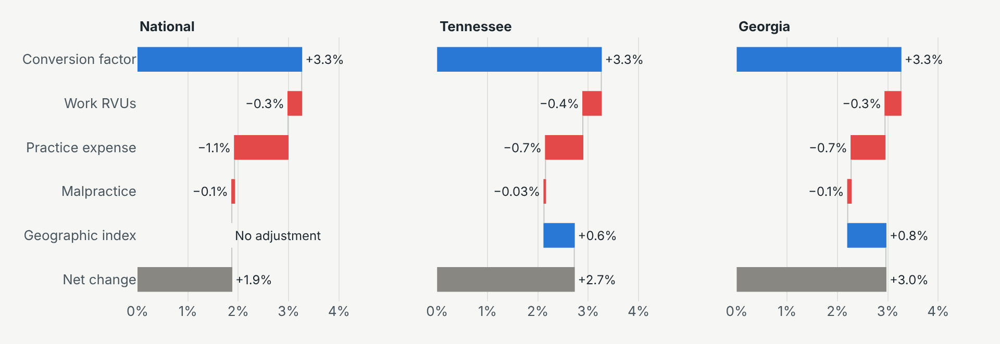
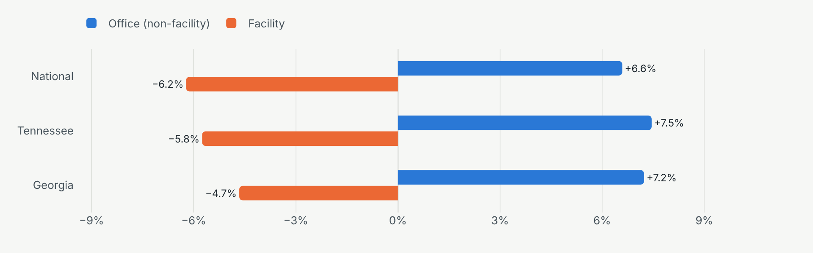

# Medicare physician fee schedule variance, 2022 to 2026

How Medicare's physician fee schedule changed from 2022 to 2026, what drove each year's change in payment, and what it meant for the same services in Chattanooga, Tennessee and Dalton, Georgia. Everything is built from CMS's own public files with Python, dbt, and DuckDB, with a Power BI model on top.

**Write-up with interactive charts:** [kiki0053.github.io/projects/medicare-fee-schedule](https://kiki0053.github.io/projects/medicare-fee-schedule/)

## What I found

- **The conversion factor fell three years running, then rose.** It went from $34.61 in 2022 to $32.35 in 2025, then up 3.3% to $33.40 for 2026 ($33.57 for qualifying APM participants). CMS has proposed $32.84 for 2027 ($33.17 for qualifying participants).
- **RVU changes cut the 3.3% raise to 1.9%.** Pricing a fixed basket of services (2024 Medicare volume) at 2025 and 2026 rates, the conversion factor added 3.3 points and lower practice expense, work, and malpractice RVUs took back 1.4, for a national increase of 1.9%. Updated geographic indexes added 0.6 points in Tennessee and 0.8 in Georgia, for net increases of 2.7% and 3.0%.
- **The money moved from facilities to offices.** CMS cut the indirect practice expense it credits to services done in hospitals and surgery centers. Office services gained 6.6% nationally (7.5% in Tennessee, 7.2% in Georgia) while facility services lost 6.2% (5.8% and 4.7%). Practice expense alone was worth about +3.5 points in offices and −8 to −9 points in facilities.
- **The 2.5% efficiency adjustment skipped office visits.** It cut work RVUs on 6,704 of the 7,278 payable codes with physician work (92%), but time-based services like visits were exempt. Nearly all surgery, radiology, and pathology volume was on adjusted codes; none of the evaluation and management volume was.
- **Medicare pays more in Dalton than in Chattanooga for facility services.** Georgia's malpractice index rose from 0.904 in 2022 to 1.192 in 2026, more than double Tennessee's 0.537. For the same service in a facility, Medicare paid a median 5.9% more in Dalton in 2026. In an office the gap was 0.4%, because Tennessee's higher practice expense index offsets most of it.

Nationally and in Tennessee, every year before 2026 was a cut. On the same 2024 basket:

| Change in payment | 2023 | 2024 | 2025 | 2026 |
|---|---:|---:|---:|---:|
| National | −0.3% | −1.0% | −2.7% | +1.9% |
| Tennessee | −0.2% | −0.9% | −2.7% | +2.7% |
| Georgia (Rest of Georgia rates) | +0.2% | −0.4% | −2.7% | +3.0% |

<picture>
  <source media="(prefers-color-scheme: dark)" srcset="docs/img/bridge-2026-dark.png">
  
</picture>

<picture>
  <source media="(prefers-color-scheme: dark)" srcset="docs/img/setting-split-dark.png">
  
</picture>

## How the numbers are built


Medicare prices a service with one formula:

```
payment = (work RVU × work GPCI + practice expense RVU × PE GPCI + malpractice RVU × MP GPCI) × conversion factor
```

Practice expense has two values, a higher one for services done in an office (non-facility) and a lower one for services done in a hospital or surgery center (facility).

To explain a change from one year to the next, `mart_payment_variance` splits it into parts that add up to the total exactly:

| Effect | Formula | Reads as |
|---|---|---|
| Conversion factor | (CF₁ − CF₀) × Σ RVU₀ × GPCI₀ | What the new conversion factor alone did to last year's payment |
| Work, PE, and MP RVUs | CF₁ × GPCI₀ × (RVU₁ − RVU₀), for each component | What CMS's RVU changes did at the new conversion factor |
| Geographic index | CF₁ × Σ RVU₁ × (GPCI₁ − GPCI₀) | What updated GPCIs did to the new RVUs |

`mart_volume_weighted_change` multiplies each code's effects by its 2024 Medicare service count, so national, Tennessee, and Georgia totals reflect what Medicare actually buys rather than counting every code equally.

### Data model

| Model | Grain | What it holds |
|---|---|---|
| `dim_release` | CMS release | Conversion factors, including both 2026 rates and the superseded January 2024 release |
| `dim_code` | HCPCS code × modifier | Description, first and last year, code family, surgery body system |
| `dim_locality` | Locality × year | Work, PE, and MP GPCIs, plus a national row with every index at 1.000 |
| `fct_rvu` | Code × modifier × year | RVUs, status, global period, payable and efficiency-adjustment flags |
| `fct_payment` | Code × year × locality × setting | Computed payment and its work, PE, and MP parts for the four focus localities |
| `mart_payment_variance` | Code × locality × setting × year-over-year change | The variance bridge above |
| `mart_volume_weighted_change` | Geography × code × setting × year | Effects priced on 2024 volume |
| `mart_efficiency_adjustment` | Code | CMS's 2026 efficiency list with before and after work RVUs and 2024 volume |
| `mart_local_comparison` | Code × setting × year | National, Tennessee, Rest of Georgia, and Atlanta payments side by side |

### Tests

`dbt build` runs 57 tests. Beyond keys, nulls, accepted values, and relationships, three custom tests check the logic itself:

- `assert_national_payment_matches_cms_totals` recomputes every national payment from its parts and compares it with CMS's own printed total RVUs times the conversion factor.
- `assert_variance_bridge_reconciles` confirms the conversion factor, RVU, and GPCI effects add up to the total change on every row.
- `assert_one_conversion_factor_per_release` fails if a CMS file ever carries two conversion factors for the same release and track.

The choices behind the numbers, such as which 2024 release to use and why some codes are left out of the weighted totals, are written up in [docs/DECISIONS.md](docs/DECISIONS.md).

## Run it yourself

You need Python 3.11 to 3.13. The download is about 70 MB from cms.gov.

```bash
python -m venv .venv
# Windows: .venv\Scripts\activate    macOS or Linux: source .venv/bin/activate
pip install -r requirements.txt

python ingest/download_cms.py      # CMS files into data/raw, with a manifest of URLs and hashes
python ingest/land_files.py        # tidy Parquet into data/landing
dbt build                          # models and tests into data/warehouse.duckdb
python analysis/build_charts.py    # chart specs and findings.json into analysis/output
python analysis/export_powerbi.py  # Parquet for Power BI into powerbi/data
```

`ingest/checksums.json` records the hashes of the files the published numbers came from. If CMS reposts one, the download step says so.

To look around the warehouse, open it with the DuckDB CLI (`duckdb data/warehouse.duckdb`) or from Python.

## Power BI

`analysis/export_powerbi.py` writes the star schema and analysis marts to `powerbi/data` as Parquet, ready for Power BI Desktop. [powerbi/BUILD_GUIDE.md](powerbi/BUILD_GUIDE.md) walks through loading them, the relationships, the DAX measures in [powerbi/measures.dax](powerbi/measures.dax), and the report pages. [powerbi/theme.json](powerbi/theme.json) matches the write-up's colors.

The exported files aren't committed because `dim_code` carries CPT descriptors (see the note under Sources). Run the pipeline to create them.

## Repository layout

```
ingest/
  download_cms.py        downloads the CMS files and logs each URL, size, and hash
  land_files.py          rebuilds CMS's multi-row headers into one tidy layout
  checksums.json         hashes of the files the published numbers used
seeds/                   release labels and CMS's proposed 2027 conversion factors
macros/                  code family, surgery body system, and code key helpers
models/
  staging/               typed views over the landed files
  marts/                 dim_code, dim_release, dim_locality, fct_rvu, fct_payment
  analysis/              variance bridge, volume-weighted change, efficiency, local comparison
tests/                   custom dbt tests
analysis/
  build_charts.py        chart specs and findings for the write-up
  export_powerbi.py      Parquet exports for Power BI
powerbi/                 DAX measures, report theme, and build guide (exports land in powerbi/data)
docs/                    modeling decisions and README images
.github/workflows/       rebuilds everything and runs the tests on each push and once a month
```

## Limits

- Fee schedule amounts are what Medicare allows for a service before the split between Medicare (80%) and the patient (20%). They leave out sequestration, multiple procedure reductions, bonus payments, and anything a commercial payer does.
- Volume is Original Medicare Part B in 2024, held fixed. Medicare Advantage claims aren't in the utilization file, and real 2026 volume will differ.
- The weighted totals cover codes with one price per setting, about 84 to 86% of 2024 allowed dollars for services paid from the fee schedule. Codes billed in separate professional and technical pieces, mostly imaging and diagnostic tests, are left out because the utilization file doesn't split them.
- Georgia's statewide volume is priced at Rest of Georgia rates, the locality that includes Dalton. Atlanta's share of that volume makes the Georgia figures an approximation.

## Sources

- [CMS PFS Relative Value Files](https://www.cms.gov/medicare/payment/fee-schedules/physician/pfs-relative-value-files): RVU22A, RVU23A, RVU24A, RVU24AR, RVU25A, RVU26A, each with its GPCI file
- [CMS CY 2026 PFS final rule, CMS-1832-F](https://www.cms.gov/medicare/payment/fee-schedules/physician/federal-regulation-notices): the list of codes subject to the efficiency adjustment
- [Medicare Physician & Other Practitioners by Geography and Service](https://data.cms.gov/provider-summary-by-type-of-service/medicare-physician-other-practitioners/medicare-physician-other-practitioners-by-geography-and-service), data year 2024

CPT® codes and descriptions are copyright the American Medical Association. This repository doesn't redistribute CPT descriptions: the pipeline reads them from CMS's files on your own machine, and the write-up describes the few codes it discusses in its own words.
